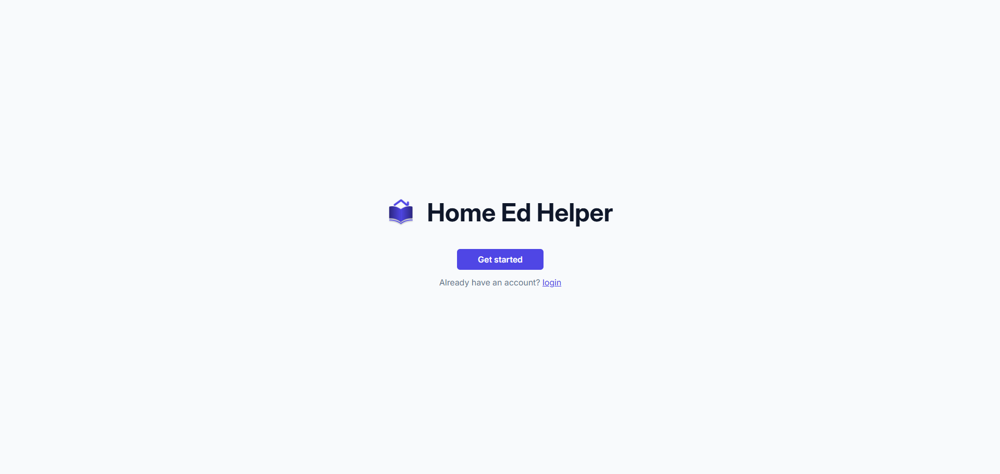
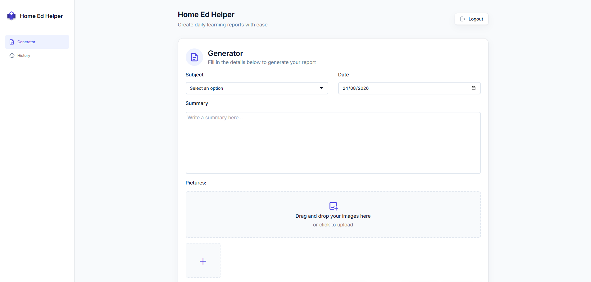
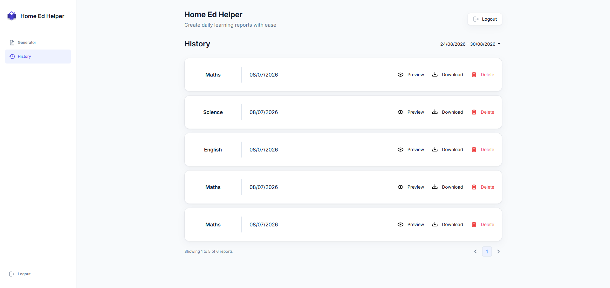

# Home Ed Helper

https://homeedhelper.netlify.app/

Home Ed Helper is an app designed to be an assistance tool for home educators, which allows users to create customised daily learning reports to keep track of learning progress and to be shown to the appropriate authorities. Users can generate a report based on subject and date, and add their own summary and images to each one. The report can then be downloaded as a PDF and saved to their profile to be viewed or downloaded again. Home educators are legally required to keep daily progress reports in the UK, and while they have previously relied on more general document generators, or created their reports from scratch, this tool is specifically designed to suit their needs and make the process easier and more concise.

## Features

- **PDF Generation**
   <p>Using the form users can generate custom, downloadable PDF's</p>
- **Image Upload**
   <p>Users can upload their own images to customise their own reports</p>
- **Report History**
   <p>Reports can be saved for future viewing or re-downloading</p>
- **Supabase Authentication**
   <p>A log in system facilitated by Supabase allows for profile creation</p>
- **Google Authentication**
    <p>Users can link their google account to log in</p>

## ScreenShots





## Technologies

 - React (vite)
 - Tailwind CSS
 - Supabase (Auth + Storage + RLS)
 - React-pdf
 - React-router
 - Vitest (testing)

## Installation and Setup

 - Clone the github repo from https://github.com/harrywoodgate/home_ed_helper.git
 - Install dependencies with your preferred package manager:  
 ### npm
```bash
npm install
```  
 ### yarn
```bash
yarn install
```
 ### pnpm
```bash
pnpm install
``` 
 - Add environment variables (see below)
 - Run the dev server:  
  ### npm
```bash
npm run dev
```  
 ### yarn
```bash
yarn dev
```
 ### pnpm
```bash
pnpm dev
``` 

## Environment Variables

Create a `.env` file in the project root and add:

VITE_SUPABASE_URL=your_supabase_url  
VITE_SUPABASE_ANON_KEY=your_supabase_anon_key

You must create your own Supabase project and supply your own keys.  
This project expects:
- a `report_uploads` table  
- a `reports` storage bucket  
- RLS enabled  
- authenticated access policies  

## Project Structure  

home-ed-helper/  
├── public/                   
├── src/  
│   ├── components/         
│   ├── hooks/              
│   ├── img/                
│   ├── utils/              
│   ├── App.jsx              
│   ├── global.css  
│   ├── main.jsx  
│   ├── routes.jsx         
│   └── supabaseClient.jsx            
│  
├── tests/          
├── eslint.config.js           
├── .env  
├── index.html       
├── package.json   
├── tailwind.config.js           
├── vite.config.js         
└── README.md               

## Testing

This project uses vitest and react testing library for unit and integration testing.

Run the test suite using your preferred package manager: 

 ### npm
```bash
npm test
```  
 ### yarn
```bash
yarn test
```
 ### pnpm
```bash
pnpm test
``` 

## Supabase Security Notes

This project uses Supabase Row Level Security (RLS) policies and storage policies to ensure security. 

Only authenticated users can read or write table data.

RLS policies include:  
 - Users can insert their own rows   
 - Users can only read rows where `user_id = auth.uid()`  
 - Users can only update or delete their own rows  

This ensures no users can access another users reports.

Storage Policies include:
 - Authenticated uploads where `auth.uid() = owner`
 - Authenticated users can delete their own files
 - Authenticated users can read files

All database and storage operations require a valid supabase session controlled by:
 - `supabase.auth.signInWithPassword()`
 - `supabase.auth.onAuthStateChange()`
 - `supabase.auth.getSession()`

For anyone wanting to set up their own backend, this project expects:
 - A `user_id` column on user-owned tables
 - RLS enabled
 - Policies restricting access to authenticated users only
 - Storage bucket policies tied to `auth.uid()`

## Future Plans

 - A feature allowing users to create an AI prompt in the summary box
 - A calendar to organise the history tab
 - More profile customisation
 - More PDF customisation
 - A generator to allow users to compile multiple reports in to one PDF

## License 

MIT